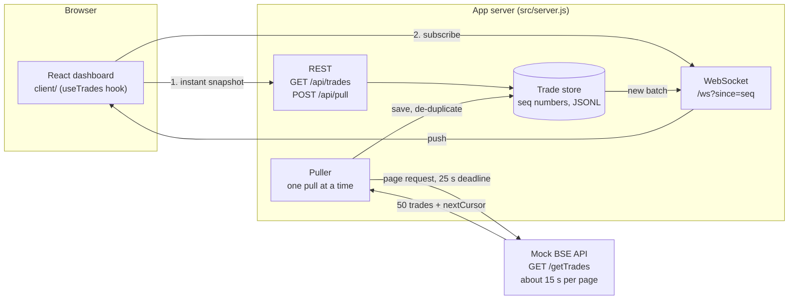
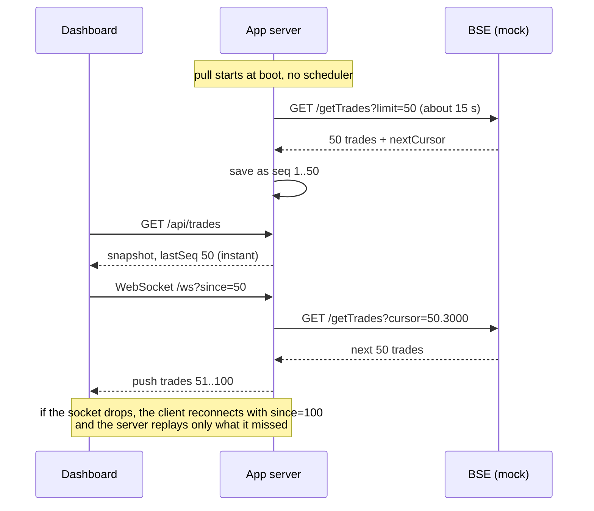

# Architecture note

## The problem

A full pull from BSE takes up to 15 minutes, and the network kills any HTTP connection held open for more than 30 seconds. A request/response design (browser asks, server fetches, browser waits) cannot work: no connection can live long enough to carry a pull, and the dashboard cannot sit and wait for one.

## The design in one sentence

Never hold a connection for the whole pull. A background puller fetches BSE in short, cursor-paged calls and saves each page as it lands. The server then pushes each saved page to open dashboards over a WebSocket.

## Diagram

## Why this design

1. **Every HTTP call is short.** The mock spreads the 15 minutes across pages, and the page size is capped so one call never exceeds 15 seconds. The puller gives each call a 25-second deadline. If a call fails, it retries from the same cursor, so a dropped connection costs one page, not the pull.
2. **Pulling and viewing are decoupled.** The puller writes to the store and the dashboard reads from it. That is why the dashboard opens instantly and shows partial data mid-pull: it reads what is already saved and never waits on BSE. The browser also never talks to BSE directly.
3. **Push instead of polling.** After an instant snapshot, the dashboard opens a WebSocket, and the server sends each new batch the moment it is saved. The browser sends no periodic requests.
4. **WebSocket, not Server-Sent Events.** SSE is a long-lived HTTP response, which is exactly what the network kills. A WebSocket is upgraded out of HTTP, and a 15-second ping keeps it alive through idle timeouts.
5. **Nothing is lost if the socket dies anyway.** Every trade has a sequence number. The client remembers the last one it saw and reconnects with `?since=<seq>`, and the server replays the gap. The snapshot-then-subscribe handoff uses the same mechanism, so there is no window where a trade can slip through.
6. **Safe to repeat.** Trades are de-duplicated by trade ID, and only one pull can run at a time (a second request gets `409`).

## Where the loops and timers are

| Place | What it does | Is it polling? |
| --- | --- | --- |
| Dashboard | Nothing periodic. It reacts to pushed messages. | No |
| Puller | Walks the cursor until BSE returns no `nextCursor`. | No. It paginates one pull and then stops. It never asks whether anything is new. |
| Pull trigger | Once at boot, and on demand via **Pull now**. | No timer or cron starts a pull. |
| 15 s heartbeat, reconnect back-off | Keeps the socket alive and re-establishes it. | No. It is transport upkeep and carries no data. |

## Alternatives considered

| Option | Why not |
| --- | --- |
| Browser calls BSE directly | Needs a 15-minute connection, and the network kills it at 30 seconds. |
| Server proxies one long BSE call | Same problem, one hop later. |
| Short or long polling from the dashboard | Ruled out by the brief, and wasteful. |
| Server-Sent Events | A long-lived HTTP response, so it would need to be rotated every few seconds. |
| Webhook or job API from BSE (submit, then get a callback) | The best option if BSE offers it, with no cursor loop at all. The rest of this design would not change: the callback handler would call `store.add` and `broadcast`. |

## Limits and what I would do next

This is a single-process demo: one app server, a JSONL file, in-memory fan-out. For production:

- Replace the file with Postgres, and use Redis or NATS pub/sub so several app instances can all push to their own sockets.
- Persist the cursor after every page so a crashed pull resumes instead of restarting.
- Run the puller as its own worker process, separate from the web tier.
- Add authentication on `/ws` and `/api`, and rate-limit **Pull now**.
- Window or virtualise the table (it shows the newest 200 rows today) and batch pushes if volume grows.
- Add BSE credentials, rate-limit handling and alerting on repeated pull failures.
